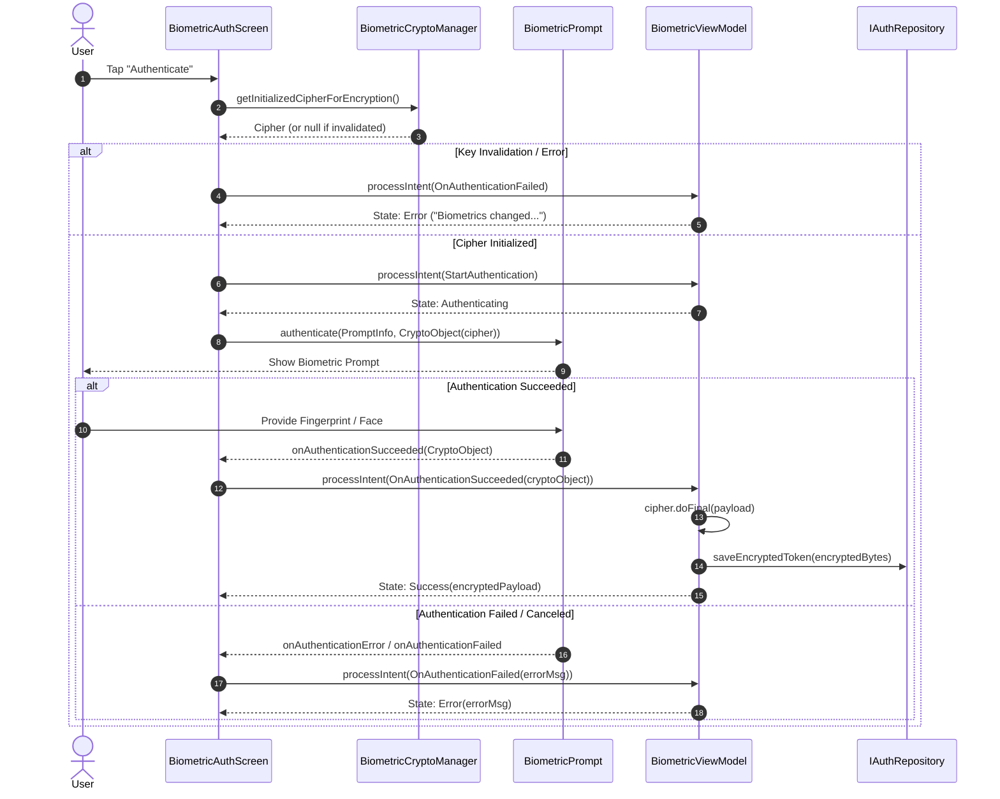

# Biometric Android

A modern, production-ready Android application demonstrating secure biometric authentication paired with hardware-backed cryptographic security using **AndroidKeyStore** and **BiometricPrompt.CryptoObject**.

Built with **Jetpack Compose**, **Kotlin Coroutines & StateFlow**, **Clean Architecture (MVI)**, and **Koin** for Dependency Injection.

---

## Key Highlights & Security Architecture

Unlike simple biometric prompts that only verify identity via software callbacks (which can be bypassed on rooted devices or hooked via Frida), this repository implements **cryptographically-bound biometric authentication**:

1. **Hardware-Backed Keystore (`AndroidKeyStore`)**
   - Cryptographic keys are generated inside the device's Secure Element (SE) or Trusted Execution Environment (TEE).
   - Algorithm: **AES / CBC / PKCS7Padding**.
2. **User Authentication Enforcement (`setUserAuthenticationRequired(true)`)**
   - The generated key cannot be used unless authorized by a successful biometric prompt.
3. **Biometric Enrollment Invalidation (`setInvalidatedByBiometricEnrollment(true)`)**
   - If a user (or unauthorized party) registers a new fingerprint or facial profile in device settings, existing keys are permanently invalidated.
4. **Strong Biometric Authentication (`BIOMETRIC_STRONG`)**
   - Enforces Class 3 (Strong) biometrics with hardware backing.
5. **MVI Architecture & Reactive State**
   - Unidirectional data flow using `BiometricIntent` and `BiometricState` powered by Kotlin `StateFlow`.

---

## Authentication & Cryptographic Flow



---

## Project Architecture & Directory Structure

This project follows **Clean Architecture** paired with **MVI (Model-View-Intent)**:

```text
app/src/main/java/com/chanchhanun/biometricandroid/
├── BiometricApp.kt                     # Application class; initializes Koin DI
├── MainActivity.kt                     # Single FragmentActivity host for Compose
├── core/
│   └── security/
│       └── BiometricCryptoManager.kt   # AndroidKeyStore key gen, AES Cipher initialization
├── di/
│   └── AppModule.kt                    # Koin modules (Crypto, Repository, ViewModel)
├── features/
│   └── auth/
│       ├── data/
│       │   └── repository/
│       │       └── AuthRepositoryImpl.kt   # Concrete implementation of IAuthRepository
│       ├── domain/
│       │   ├── repository/
│       │   │   └── IAuthRepository.kt      # Domain contract for token storage
│       │   └── state/
│       │       └── BiometricState.kt       # BiometricState & BiometricIntent definitions
│       └── representation/
│           ├── ui/
│           │   └── BiometricAuthScreen.kt  # Jetpack Compose UI & BiometricPrompt trigger
│           └── viewmodel/
│               └── BiometricViewModel.kt   # MVI ViewModel handling state & encryption
└── ui/
    └── theme/                              # Material 3 Color, Type, and Theme setups
```

### Component Breakdown

| Layer | Component | Responsibility |
|---|---|---|
| **Core** | `BiometricCryptoManager` | Generates AES-256 keys in `AndroidKeyStore` with user authentication requirements and cipher creation. |
| **Domain** | `BiometricState` | Represents UI states: `Idle`, `Authenticating`, `Success`, `Error`. |
| **Domain** | `BiometricIntent` | Represents user actions: `StartAuthentication`, `OnAuthenticationSucceeded`, `OnAuthenticationFailed`. |
| **Domain** | `IAuthRepository` | Abstraction layer for storing/retrieving encrypted authentication payloads. |
| **Data** | `AuthRepositoryImpl` | Handles I/O operations for persisted encrypted payloads. |
| **Presentation** | `BiometricViewModel` | Consumes `BiometricIntent`, runs `cipher.doFinal()`, and exposes immutable `StateFlow<BiometricState>`. |
| **Presentation** | `BiometricAuthScreen` | Jetpack Compose UI reacting to state and presenting system `BiometricPrompt`. |
| **DI** | `AppModule` | Injects dependencies cleanly via Koin DSL. |

---

## Tech Stack & Dependencies

| Dependency | Purpose | Version |
|---|---|---|
| **Kotlin** | Programming Language | `2.2.10` |
| **Android Gradle Plugin** | Build system | `9.5.1` |
| **Jetpack Compose** | Declarative Modern UI | `Compose BOM 2026.02.01` |
| **Material 3** | Material Design UI Components | Compose BOM |
| **AndroidX Biometric** | BiometricPrompt APIs & CryptoObject | `1.2.0-alpha05` |
| **AndroidX Fragment KTX** | FragmentActivity integration for Biometrics | `1.6.2` |
| **AndroidX Lifecycle & ViewModel** | Lifecycle-aware StateFlow & ViewModel | `2.7.0` |
| **KotlinX Coroutines** | Asynchronous programming & thread dispatching | `1.7.3` |
| **Koin** | Lightweight Dependency Injection for Kotlin & Compose | `3.5.3` |

---

## Permissions

Declared in `AndroidManifest.xml`:

```xml
<uses-permission android:name="android.permission.USE_BIOMETRIC" />
```

---

## Getting Started

### Prerequisites

- **Android Studio** (Koala / Ladybug or newer recommended)
- **Android SDK**:
  - `minSdk = 24` (Android 7.0 Nougat)
  - `targetSdk = 37`
  - `compileSdk = 37`
- **JDK**: Java 11 or higher
- Physical Android device with Biometric hardware (Fingerprint / Face Unlock) or Android Emulator configured with Fingerprint under Emulator Extended Controls.

### Setup & Run

1. **Clone the repository:**
   ```bash
   git clone https://github.com/chanchhanun/biometric-android.git
   cd biometric-android
   ```

2. **Open in Android Studio:**
   - Select **File > Open...** and select the `biometric-android` directory.
   - Wait for Gradle sync to complete.

3. **Run on Device or Emulator:**
   - Connect a device with biometric security enabled (PIN/Fingerprint configured in system settings).
   - Click **Run** (`Shift + F10` / `Ctrl + R`).

4. **Testing on Emulator:**
   - If using the emulator, open **Extended Controls** (`...` icon on emulator toolbar) > **Fingerprint**.
   - Ensure a fingerprint lock is enrolled in Android Settings.
   - Touch the sensor emulation button when prompted by the app.

---

## Practical Production Enhancements

When adapting this template for full production applications:

- **Decryption Flow**: Save the cipher's initialization vector (`cipher.iv`) alongside the encrypted payload. To decrypt, initialize the cipher with `Cipher.DECRYPT_MODE`, the secret key, and `IvParameterSpec(iv)` inside a biometric prompt callback.
- **Secure Storage**: Implement `AuthRepositoryImpl` with `EncryptedSharedPreferences` or Android Jetpack `DataStore` with security encryption.
- **Fallback to Device Credential**: If device PIN/Pattern is desired as a fallback, configure `.setAllowedAuthenticators(BIOMETRIC_STRONG or DEVICE_CREDENTIAL)`. Note: using `DEVICE_CREDENTIAL` disables `.setInvalidatedByBiometricEnrollment(true)`.

---

## 📄 License

This project is open-source and available under the [MIT License].
